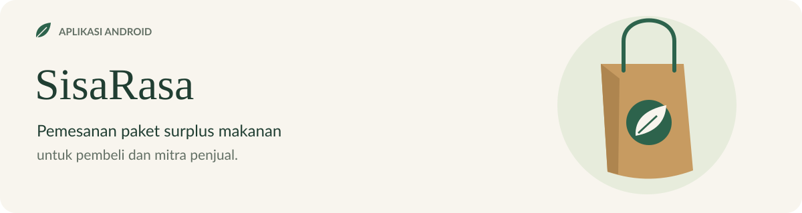
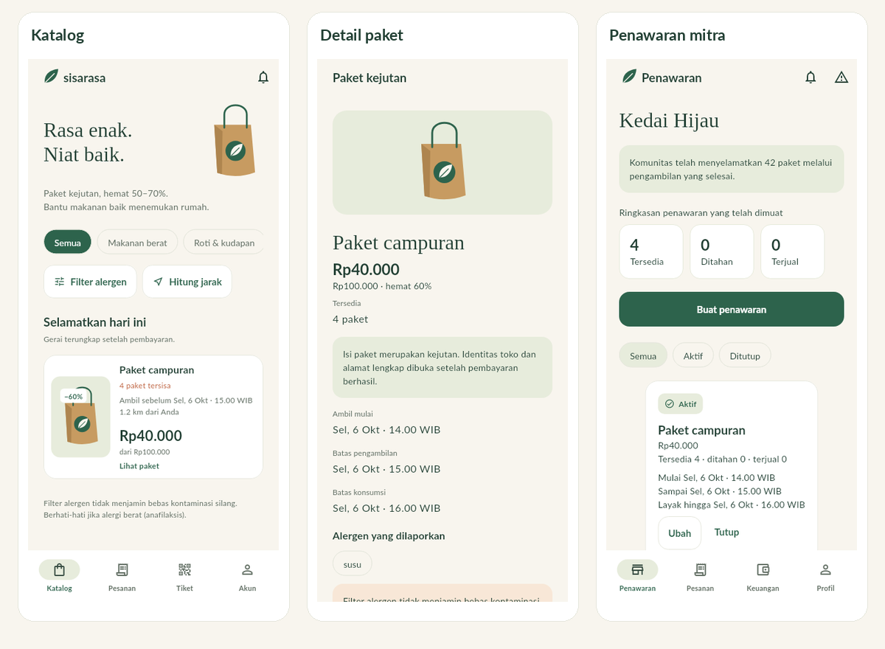
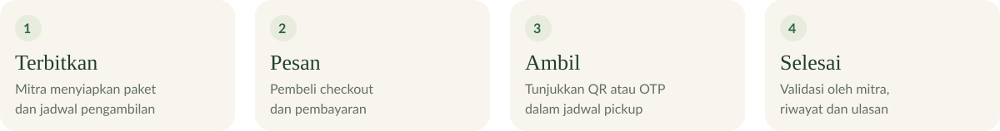
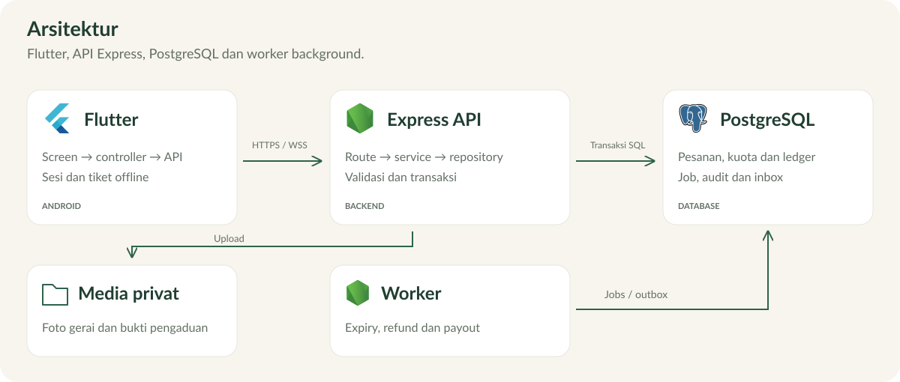
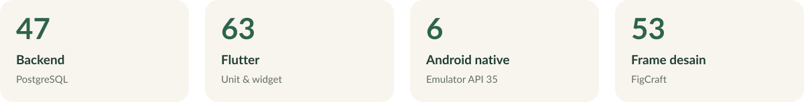

<p align="center">
  
</p>

<p align="center">
  <a href="https://github.com/aniceswan/sarirasa/actions/workflows/ci.yml"></a>
</p>

<p align="center">
  <a href="#mulai-lokal"><strong>Mulai lokal</strong></a> &nbsp; · &nbsp;
  <a href="src/README.md">Dokumentasi</a> &nbsp; · &nbsp;
  <a href="src/design/sisarasa.figcraft">Desain FigCraft</a> &nbsp; · &nbsp;
  <a href="https://github.com/aniceswan/sarirasa/issues/new/choose">Issue</a>
</p>

SisaRasa menghubungkan penjual surplus makanan dengan pembeli melalui paket kejutan berdiskon **50–70%**. Pembeli memesan, melakukan pembayaran<sup><a href="#catatan">1</a></sup>, lalu mengambil paket menggunakan **QR atau OTP**. Identitas gerai ditampilkan setelah pembayaran berhasil.

## Tampilan aplikasi



[Katalog](src/docs/assets/catalog.png) · [Detail paket](src/docs/assets/offer-detail.png) · [Penawaran mitra](src/docs/assets/seller-dashboard.png) · [Desain FigCraft](src/design/sisarasa.figcraft)

## Fitur

| Pembeli | Mitra penjual |
| --- | --- |
| Katalog, kategori dan filter alergen | Profil gerai dan pengelolaan penawaran |
| Checkout dan pembayaran | Kuota, harga dan jadwal pengambilan |
| Tiket QR/OTP yang dapat dibuka offline | Validasi pengambilan lewat scan atau OTP |
| Riwayat pesanan, pengaduan dan ulasan | Inbox, tanggapan pengaduan dan pencairan |



[Use case UC01–UC07](src/README.md#fitur) · [Panduan penggunaan](src/README.md#coba-aplikasi)

## Teknologi

<p align="center">
   &nbsp;
   &nbsp;
   &nbsp;
   &nbsp;
   &nbsp;
   &nbsp;
   &nbsp;
   &nbsp;
</p>

<p align="center"><sub>Flutter · Dart · Node.js · TypeScript · Express · PostgreSQL · Docker · Android</sub></p>

[Versi dan dependensi](src/README.md#teknologi)

## Arsitektur

Aplikasi Flutter berkomunikasi dengan API Express melalui HTTPS/WSS. API dan worker menggunakan PostgreSQL. Foto gerai dan bukti pengaduan disimpan sebagai media privat.



[Penjelasan arsitektur](src/README.md#arsitektur) · [Struktur folder](src/README.md#struktur-folder) · [Database](src/README.md#database-dan-penyimpanan) · [API](src/backend/openapi.yaml)

## Mulai lokal

Prasyarat: Docker Compose dan Python untuk backend; Flutter, JDK dan Android SDK untuk aplikasi. [Panduan instalasi lengkap](src/README.md#mulai-lokal).

```bash
cd src
./scripts/setup.sh
./scripts/start.sh
./scripts/seed.sh
```

Jalankan aplikasi dari folder `src/android-app`:

```bash
flutter pub get --enforce-lockfile
flutter run --dart-define=API_BASE=http://10.0.2.2:3100
```

Akun uji tersimpan di `.secrets/demo-access.txt` setelah seed. Konfigurasi server ditentukan saat build dan tidak ditampilkan di aplikasi pengguna.

## Pengujian



Pengujian lokal pada **5 November 2026** mencakup transaksi, backup/restore, tiket offline dan notifikasi Android. Typecheck dan Flutter analyze lulus.

[Laporan pengujian](src/docs/verification.md) · [Jalankan test](src/README.md#pengujian-lokal) · [Profiling](src/docs/evidence/benchmark.json)

## Dokumentasi

| Dokumen | Isi |
| --- | --- |
| [README aplikasi](src/README.md) | Instalasi, konfigurasi, penggunaan dan troubleshooting |
| [Struktur modul](src/README.md#mengerjakan-issue) | Lokasi file untuk mengerjakan issue |
| [Kontribusi](CONTRIBUTING.md) | Branch, issue, commit dan PR |
| [Operasi](src/docs/operations.md) | Server, backup dan pemulihan |
| [Traceability](src/docs/traceability.md) | Pemetaan SKPL/DPPL ke implementasi |
| [Laporan M9](docs/M9/K01_G06_Implementasi.md) | Implementasi dan ketentuan milestone |
| [AI usage](docs/K01_G06_AI-Usage.md) dan [logbook](docs/K01_G06_Logbook.md) | Catatan pengerjaan |

Source berada di **`src/`**. Pengumpulan resmi dilakukan di [repo akademik IF2150-RPL-K01-G06](https://github.com/zakyamani/IF2150-RPL-K01-G06).

## Catatan

1. Pembayaran, rekening, fee, refund dan pencairan menggunakan simulasi; tidak ada transfer uang nyata. Screenshot menggunakan data fiktif.
2. Pengujian kamera dua HP, perangkat minimum dan baterai OEM belum dilakukan. Batas pengujian tercantum dalam [laporan](src/docs/verification.md).
