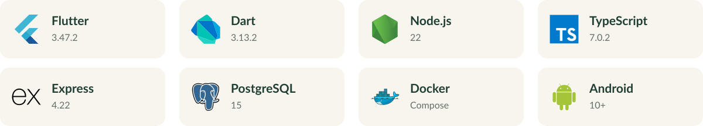
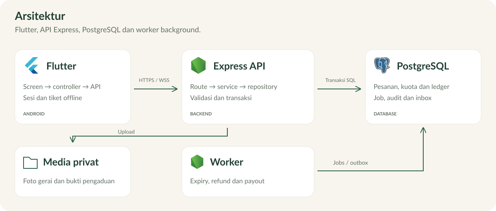
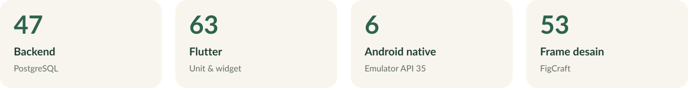

<p><a href="../README.md">← Ringkasan proyek</a></p>


# Dokumentasi SisaRasa

Android marketplace paket kejutan surplus makanan: penjual menerbitkan paket yang masih layak, pembeli memesan dengan diskon 50–70%, lalu mengambilnya memakai QR atau OTP. Identitas gerai dibuka sesudah pembayaran. Pembayaran dan pencairan dijelaskan pada [catatan](#catatan).

<p></p>

## Daftar isi

- [Teknologi](#teknologi)
- [Struktur folder](#struktur-folder)
- [Arsitektur](#arsitektur)
- [Alur transaksi](#alur-transaksi)
- [Database dan penyimpanan](#database-dan-penyimpanan)
- [Mulai lokal](#mulai-lokal)
- [Konfigurasi](#konfigurasi)
- [Fitur](#fitur)
- [Coba aplikasi](#coba-aplikasi)
- [Mengerjakan issue](#mengerjakan-issue)
- [Pengujian lokal](#pengujian-lokal)
- [Build release dan operasi](#build-release-dan-operasi)
- [Masalah umum](#masalah-umum)

## Teknologi

Diuji dengan Flutter **3.47.2**, Dart **3.13.2**, Node **22.18**, TypeScript **7.0.2**, Express **4.22**, PostgreSQL **15**, Docker Compose, Python **3.12**, JDK **21**, Android SDK **36**. Android minimum **10/API29**. Versi dependensi terikat di [package-lock.json](backend/package-lock.json) dan [pubspec.lock](android-app/pubspec.lock).

## Struktur folder

Struktur dari root repo:

| Bagian | Fungsi |
| --- | --- |
| `android-app/` | Tampilan, controller, perangkat dan cache tiket |
| `backend/` | HTTP, aturan transaksi, SQL, notifikasi dan worker |
| `scripts/`, `deploy/` | Menjalankan, menguji, build dan operasi |
| `design/`, `docs/` | Desain dan laporan pengujian |

<details>
<summary><strong>Buka struktur folder lengkap</strong></summary>

```text
sarirasa/
├── README.md                       Ringkasan proyek
├── CONTRIBUTING.md                 Branch, issue, PR dan review tim
├── SECURITY.md                     Aturan kredensial dan pelaporan
├── .github/
│   ├── ISSUE_TEMPLATE/             Form bug dan usulan
│   ├── pull_request_template.md    Template pull request
│   └── workflows/ci.yml            Backend/PostgreSQL dan Flutter di CI
├── docs/                           Laporan M9, AI usage dan logbook
└── src/                            Seluruh implementasi sesuai M9
    ├── README.md                   Panduan utama aplikasi ini
    ├── .env.example                Daftar konfigurasi tanpa rahasia
    ├── android-app/
    │   ├── lib/
    │   │   ├── main.dart           Startup dan konfigurasi build
    │   │   ├── app.dart            Root aplikasi dan navigasi peran
    │   │   ├── app_services.dart   Perakitan API, sesi, tiket dan notifikasi
    │   │   ├── core/               API, model, storage, tema dan widget bersama
    │   │   └── features/           auth, buyer, seller, orders, notifications, settings
    │   ├── android/                Manifest, permission, Gradle dan plugin native
    │   ├── assets/fonts/           Font beserta lisensinya
    │   ├── test/                   Unit, controller, widget dan aksesibilitas
    │   └── integration_test/       Enam skenario native Android
    ├── backend/
    │   ├── src/
    │   │   ├── index.ts            Startup HTTP API
    │   │   ├── app.ts              Middleware, route dan WebSocket server
    │   │   ├── worker.ts           Proses job/outbox di background
    │   │   ├── core/               Database, auth, crypto, error dan kontrak bersama
    │   │   └── modules/            Route, service, repository dan schema per fitur
    │   ├── migrations/             SQL bernomor, constraint dan index
    │   ├── scripts/                Migrasi, seed dan test runner backend
    │   ├── test/                   Unit, integration, e2e, operasi dan profiling
    │   └── openapi.yaml            Kontrak API
    ├── scripts/                    Operator setup/start/stop/backup/test/build
    ├── compose.yaml               API, worker, migrasi dan PostgreSQL lokal
    ├── compose.test.yaml          PostgreSQL disposable untuk test
    ├── compose.vps.yaml           Tambahan Caddy HTTPS untuk VPS
    ├── cloudflared/                Konfigurasi tunnel opsional
    ├── deploy/                     Reverse proxy dan timer backup
    ├── design/                     Desain FigCraft final dan inventaris layar
    ├── docs/                       Operasi, traceability, screenshot dan bukti test
    └── tests/README.md             Indeks lokasi pengujian lintas toolchain
```

</details>

`node_modules/`, `build/`, `.dart_tool/`, `.env`, `.secrets/`, `uploads/`, `backups/` dan APK pada `artifacts/` dibuat lokal dan diabaikan Git. Clone baru tidak membutuhkan salinan folder hasil build dari pengembang lain.

## Arsitektur

Sistem memakai **client-server dengan layer per fitur**. Flutter menangani interaksi/perangkat; API memegang aturan bisnis dan otorisasi; PostgreSQL menyimpan state transaksi. API dan worker adalah dua proses dari source backend yang sama. Worker memakai PostgreSQL sebagai penyimpanan antrean, tanpa Redis atau akun message broker tambahan.



<details>
<summary>Diagram versi teks</summary>

```text
Android Flutter
  screen → controller/repository → ApiClient
          │ HTTPS JSON / WSS
          ▼
Caddy HTTPS (VPS; pada development API diakses langsung)
          ▼
Express API: middleware → route → service → repository
          │ transaksi SQL                 │ media privat
          ▼                               ▼
PostgreSQL                            uploads/
  orders / ledger / audit / jobs / outbox
          ▲
          │ klaim job, retry, expiry, refund, payout, publikasi outbox
Worker background
```

</details>

### Flutter

- **Screen** membangun widget, menampilkan state/error dan menerima tindakan pengguna. Screen tidak mengakses database atau menetapkan keberhasilan pembayaran sendiri.
- **Controller/repository fitur** menjalankan permintaan, validasi form, state loading dan pemulihan operasi. `features/buyer/` menangani katalog/alergen; `seller/` penawaran/profil/scan; `orders/` checkout, tiket, riwayat, pengaduan dan ulasan.
- **Core API/storage** menangani autentikasi request, refresh token, perubahan sesi, upload dan cache tiket. `SessionStore` memisahkan akun; `TicketCache` menyimpan tiket paid melalui secure storage. Gagal jaringan dapat memakai tiket tersimpan, sedangkan validasi pickup tetap harus online.
- **Tema/widget bersama** pada `core/theme/` dan `core/widgets/` menjaga warna, font, spacing kontrol dan ilustrasi tas. `AppServices` merakit dependensi sehingga test dapat mengganti HTTP/storage tanpa memalsukan perilaku server dalam test integrasi backend.

### Backend

Setiap fitur pada `backend/src/modules/` memisahkan **route** (HTTP/identitas), **schema** bila diperlukan (bentuk input), **service** (aturan dan transaksi) dan **repository** (query parameterized). Modul kecil dapat memakai sebagian lapisan tersebut. Aturan kuota, kepemilikan dan status tetap ditegakkan di backend, walaupun UI juga melakukan validasi agar pengguna mendapat pesan cepat.

`core/db.ts` mengelola koneksi/transaksi; `core/auth.ts` otorisasi; `core/crypto.ts` hashing/enkripsi; `core/effects.ts` mencatat efek ledger/audit/notifikasi/job dalam transaksi terkait. Foreign key, unique/check constraint dan row lock melindungi state saat request bersamaan. `Idempotency-Key` memungkinkan retry checkout kembali ke transaksi yang sama.

### Worker dan notifikasi

`worker.ts` memeriksa job/outbox berkala. Job persisten mencakup kedaluwarsa pembayaran, no-show, refund toko tutup, settlement payout simulasi dan cleanup. Klaim memakai row lock, lease dan token lease; job yang gagal dapat dicoba kembali dengan jeda meningkat. Efek bisnis dirancang idempotent agar retry tidak menggandakan saldo/refund.

Notifikasi berasal dari outbox/inbox persisten. WebSocket menyampaikan pembaruan saat tersambung; cursor catch-up menyusulkan event yang terlewat. Foreground monitoring Android bersifat opt-in dan dapat dihentikan sistem. Inbox tetap menjadi sumber riwayat, sehingga layanan tidak menjanjikan push selalu hidup ketika aplikasi mati.

## Alur transaksi


1. **Penawaran:** mitra membuat paket, kuota, harga, alergen dan jadwal; server memeriksa kelayakan input dan aturan diskon/waktu. Pembeli mendapat katalog anonim tanpa identitas gerai sebelum paid.
2. **Checkout:** server menahan satu kuota dalam transaksi dan menerbitkan invoice. Retry dengan idempotency key yang sama memakai hasil sebelumnya. Kuota yang ditahan tidak dapat dibeli ulang oleh pembeli lain.
3. **Pembayaran demo:** callback terverifikasi memindahkan order ke paid atau membatalkannya sesuai hasil/deadline. Pembayaran sukses menerbitkan QR/OTP dan membuka gerai. Callback duplikat tidak menggandakan penjualan.
4. **Pengambilan:** pembeli menunjukkan tiket; mitra memindai QR atau memasukkan kode pesanan dan OTP. Backend memeriksa pemilik, jadwal dan token sekali pakai sebelum menyelesaikan order. Tiket offline hanya sarana menampilkan bukti tersimpan.
5. **Setelah transaksi:** order selesai dapat diulas. Pengaduan/pembatalan mengikuti aturan status dan dapat menahan atau membatalkan payout simulasi. Worker menangani tenggat dan settlement; riwayat mencatat perubahan status.

## Database dan penyimpanan

Skema beserta **atribut, tipe, foreign key, constraint dan index** adalah sumber kebenaran di [001_initial.sql](backend/migrations/001_initial.sql) dan [002_background_indexes.sql](backend/migrations/002_background_indexes.sql). Migrasi bernomor memiliki checksum dan dijalankan lewat script migrasi; jangan mengedit SQL migrasi yang sudah diterapkan pada deployment.

| Kelompok | Tabel | Fungsi |
| --- | --- | --- |
| Identitas | `users`, `sessions`, `merchant_profiles` | Akun/peran, sesi refresh dan profil mitra |
| Marketplace | `offers`, `orders`, `checkout_reservations` | Penawaran, snapshot pesanan, kuota dan reservasi |
| Pembayaran | `payment_intents`, `payment_events`, `refunds` | Invoice, deduplikasi callback dan refund demo |
| Pengambilan | `pickup_credentials` | Credential QR/OTP yang terikat pesanan |
| Media/pengaduan | `media_assets`, `complaints`, `complaint_media` | Media privat, laporan dan bukti |
| Keuangan demo | `payout_entitlements`, `payout_events`, `ledger_entries` | Hak pencairan, event dan pencatatan nominal |
| Riwayat/ulasan | `reviews`, `audit_logs` | Ulasan pesanan selesai dan jejak perubahan |
| Background/notifikasi | `notifications`, `outbox`, `jobs` | Inbox, pengiriman event dan pekerjaan persisten |
| Pengamanan request | `idempotency_keys`, `rate_buckets`, `ws_tickets` | Retry aman, pembatasan percobaan dan tiket WebSocket |

Database berada pada volume Docker; berkas media pada `uploads/` dengan akses privat. Tiket perangkat berada di secure storage Android. Ketiganya memiliki fungsi berbeda: cache ponsel tidak menggantikan database, dan backup database saja tidak cukup untuk memulihkan media/kunci dekripsi. Prosedur lengkap ada di [operasi](docs/operations.md).

## Mulai lokal

Prasyarat Linux: Git, Docker Engine dengan plugin Compose, Python 3.12+, Node 22 dan npm. Pengguna harus dapat menjalankan `docker` tanpa prompt interaktif. Untuk Android pasang Flutter 3.47.2, JDK21, SDK36/build tools36 serta terima lisensi Android dengan `flutter doctor --android-licenses`. Periksa `flutter doctor` sebelum build.

```bash
git clone https://github.com/aniceswan/sarirasa.git
cd sarirasa/src
./scripts/setup.sh
./scripts/start.sh
./scripts/health.sh
./scripts/seed.sh
```

Setup membuat `.env` privat dengan secret acak, membangun image, menyiapkan PostgreSQL dan menjalankan migrasi. Tidak memerlukan akun layanan cloud. Seed opsional membuat akun/penawaran **fiktif**; kredensial baru tersimpan di `.secrets/demo-access.txt` (hanya pengguna lokal yang dapat membaca). File tersebut memuat akun pembeli dan mitra. Seed tidak dijalankan otomatis dan tidak mereset akun lama. Penawaran contoh berakhir dalam dua jam; buat ulang penawaran melalui akun mitra jika habis. Registrasi kedua peran juga tersedia dari aplikasi.

API lokal: `http://127.0.0.1:3100`; health: `/health/ready`. Database hanya bind localhost port55432. Bila port dipakai proyek lain, jalankan setup pertama dengan `API_HOST_PORT=3101 DB_HOST_PORT=55435 ./scripts/setup.sh`, lalu sesuaikan `API_BASE` pada build Android. Semua konfigurasi ada di [.env.example](.env.example). Jangan mengganti secret yang sudah dipakai pada database/tiket lama.

Jalankan di emulator Android:

```bash
cd android-app
flutter pub get --enforce-lockfile
flutter run --dart-define=API_BASE=http://10.0.2.2:3100
```

`10.0.2.2` adalah jembatan emulator ke host. Pada HP fisik gunakan endpoint HTTPS yang dapat dijangkau; [panduan VPS](docs/vps-deployment.md) dan [operasi/tunnel](docs/operations.md) menjelaskan setup operator. HTTP hanya di debug. Origin diatur saat build; pengguna tidak perlu melihat IP, URL server, UUID internal atau mengubah konfigurasi jaringan. Kontrol operator hanya muncul jika sengaja dibuild dengan `--dart-define=DEVELOPER_SETTINGS=true`.

## Konfigurasi

Setup pertama menghasilkan `.env` privat; contoh nama variabel ada di [.env.example](.env.example). Konfigurasi server dibaca saat proses dimulai; konfigurasi aplikasi ditetapkan ketika Flutter dibuild.

| Variabel | Pemakaian |
| --- | --- |
| `POSTGRES_PASSWORD`, `DATABASE_URL` | Kredensial dan koneksi PostgreSQL; dihasilkan setup, tidak dipublikasikan |
| `ACCESS_SECRET` | Penandatanganan access token |
| `CALLBACK_SECRET` | Verifikasi callback gateway demo; terpisah dari secret autentikasi |
| `PICKUP_KEY` | Kunci enkripsi credential pickup; pertahankan bersama backup |
| `FEE_BPS` | Fee simulasi dalam basis point; default500 =5% |
| `API_HOST_PORT`, `DB_HOST_PORT` | Port localhost API/database; default3100/55432 |
| `APP_UID`, `APP_GID` | UID/GID container non-root; setup mengikuti operator lokal, fallback1000 bila dijalankan root |
| `TRUST_PROXY`, `CORS_ORIGINS` | Proxy yang dipercaya dan origin browser yang diizinkan; jangan mempercayai semua alamat proxy |
| `MEDIA_DIR` | Lokasi media dalam container |
| `PUBLIC_HOST` | Hostname HTTPS untuk profil VPS/Caddy |
| Flutter `API_BASE` | Origin API pada `--dart-define`; HTTPS untuk release |
| Flutter `DEVELOPER_SETTINGS` | Defaultfalse; kontrol server hanya untuk build operator yang sengaja mengaktifkannya |
| `SISARASA_SIGNING_FILE` | Path privat signing configuration bila tidak memakai lokasi default proyek |
| `ANDROID_SERIAL` | Emulator khusus yang dipakai native runner |

IP/URL server dibutuhkan **operator** untuk build/deployment dan tidak muncul pada UI pengguna normal. Jangan memasukkan nilai rahasia ke file contoh atau issue publik.

## Fitur

| Use case | Implementasi |
| --- | --- |
| UC01 | Penawaran, diskon, kuota, delapan alergen, jadwal/batas konsumsi, konfirmasi kelayakan dan aturan edit/tutup |
| UC02 | Katalog anonim, kategori/filter alergen, lokasi opsional dan perkiraan jarak |
| UC03 | Checkout idempotent, invoice, pembayaran demo berhasil/gagal/kedaluwarsa, identitas gerai setelah paid |
| UC04 | Dashboard mitra, pesanan/jadwal, inbox persisten dan pembaruan pesanan |
| UC05 | QR sekali pakai, OTP, validasi online, tiket terenkripsi yang dapat dibuka offline |
| UC06 | Pengaduan dengan bukti privat, approve/reject, pembatalan dan refund, no-show dan worker timeout |
| UC07 | Riwayat status, ulasan hanya pesanan selesai, metrik paket terselamatkan dan pencairan simulasi |

[Pemetaan kebutuhan/kelas](docs/traceability.md) · [Kontrak API](backend/openapi.yaml) · [Skema dan atribut database](backend/migrations/001_initial.sql) · [Alur kerja tim](../CONTRIBUTING.md). Pembagian modul dan kontribusi anggota dicatat melalui issue dan PR.

## Coba aplikasi

1. Jalankan backend, migrasi dan seed; baca kredensial fiktif dari `.secrets/demo-access.txt`, atau registrasikan akun pembeli dan mitra sendiri.
2. Masuk sebagai mitra, lengkapi profil/lokasi gerai, lalu buat penawaran yang jadwal dan batas konsumsinya masih berlaku. Konfirmasi kelayakan makanan wajib dipilih secara sadar.
3. Masuk sebagai pembeli pada emulator/perangkat kedua, atau keluar lalu ganti akun. Telusuri kategori/alergen, pilih paket dan checkout. Periksa simulasi sukses/gagal pada pembayaran.
4. Setelah sukses, buka alamat gerai serta tiket. Mitra melakukan validasi dalam jadwal pengambilan melalui scan atau kode pesanan/OTP. Untuk demo satu perangkat, catat kode sebelum berganti akun karena logout menghapus tiket privat lokal.
5. Setelah selesai, pembeli dapat memberi ulasan; mitra memeriksa riwayat dan keuangan demo. Gunakan pesanan paid lain untuk mencoba pengaduan/pembatalan sebelum pickup.
6. Untuk uji offline, sinkronkan tiket paid terlebih dahulu, tetap berada pada akun pembeli yang sama, lalu putuskan jaringan. Tiket tersimpan dapat dibuka; penyelesaian oleh mitra tetap online.

Jangan memakai data bank nyata. Untuk pengujian waktu/expiry yang terkontrol gunakan integration test dengan clock fixture; tidak ada endpoint publik untuk mengubah waktu atau mereset database.

## Mengerjakan issue

| Perubahan | Mulai dari |
| --- | --- |
| Warna, tipografi, tombol, ilustrasi | `android-app/lib/core/theme/` dan `core/widgets/` |
| Login, akun dan sesi | `features/auth/`, `core/storage/`, `backend/src/modules/auth/` |
| Katalog/filter dan penawaran mitra | Flutter `features/buyer/`, `features/seller/`; backend `catalog/`, `offers/`, `merchants/` |
| Checkout/pembayaran dan tiket | Flutter `features/orders/`; backend `orders/`, `payments/`, `pickup/` |
| Scan dan OTP | Flutter `features/seller/scan_*`, `otp_screen.dart`; backend `pickup/` |
| Pengaduan, ulasan, payout | Layar/controller fitur terkait; backend `complaints/`, `reviews/`, `payouts/` |
| Inbox dan background | Flutter `features/notifications/`; backend `notifications/`, `jobs/`, `worker.ts` |
| Perubahan skema | Tambahkan migrasi bernomor pada `backend/migrations/`, lalu sesuaikan repository/kontrak/test |
| Deploy/build/backup | `scripts/`, `compose*.yaml`, `deploy/`, panduan `docs/` |

Untuk perubahan kontrak, perbarui [OpenAPI](backend/openapi.yaml), model/parser Flutter dan test terkait bersama-sama. Aturan bisnis harus diuji di service/PostgreSQL, tidak cukup dengan widget test. Ikuti [CONTRIBUTING](../CONTRIBUTING.md) untuk issue, branch, commit dan review anggota lain.

## Pengujian lokal



Dari folder `src/`:

```bash
./scripts/test.sh
python3 scripts/test/signing_test.py
./scripts/benchmark.sh
```

`test.sh`: database PostgreSQL disposable port55433, `npm ci`, typecheck, backend/operasi backup, `flutter pub get`, analyze dan widget/unit test. Benchmark mereset database test yang sama, jadi jalankan berurutan, jangan paralel dengan backend tests. Semua fixture fiktif; data marketplace lokal di port55432 tidak digunakan oleh test.

Native E2E memerlukan API/worker lokal hidup dan emulator Android15 x86_64 **khusus pengujian**:

```bash
ANDROID_SERIAL=emulator-5580 ./scripts/e2e.sh
```

Runner memasang APK debug/instrumentation dan menyesuaikan sementara izin/timeout pada emulator. Jangan memakai HP pribadi berisi data pengguna. Marketplace harus mendahului recovery karena recovery menguji tiket dari proses sebelumnya. Jika build emulator lama ditandatangani dengan key lain, gunakan AVD pengujian kosong. Lihat [hasil verifikasi](docs/verification.md) untuk kondisi dan batas bukti; widget test tidak membuktikan kamera HP fisik.

## Build release dan operasi

```bash
./scripts/setup-signing.sh
./scripts/build-apk.sh https://HOST_API_ANDA
./scripts/backup.sh ./backups
./scripts/restore.sh ./backups/sisarasa-TIMESTAMP --test
./scripts/stop.sh
```

Signing key/password berada di `.secrets/` dan `android-app/android/key.properties`, tidak masuk Git. Build release menghasilkan `artifacts/sisarasa.apk` dan manifest SHA-256; tidak menggunakan debug key. Simpan APK sebagai asset Release tim, jangan commit binary build. Keystore harus dibackup privat agar update memakai identitas yang sama.

Database/media persisten saat stop. Backup menyertakan dump, media dan recovery secret, memulihkan layanan setelah kegagalan, serta menguji restore di tempat terpisah. Salin backup terenkripsi ke luar host. Jangan menghapus volume atau mengganti `PICKUP_KEY` saat tiket lama masih aktif.

Registrasi merchant belum mencakup verifikasi identitas fisik. Informasi alergen dan batas konsumsi diisi oleh merchant. Pemantauan notifikasi memerlukan izin dan mengikuti batas Android.

## Masalah umum

| Gejala | Pemeriksaan |
| --- | --- |
| Port3100/55432 dipakai | Pilih port lain saat setup pertama; sesuaikan API_BASE. Jangan menghentikan proyek lain tanpa memeriksa pemiliknya. |
| Emulator tidak terhubung | Backend harus ready; emulator memakai `10.0.2.2`, bukan localhost perangkat. Periksa serial lewat `adb devices`. |
| HP fisik tidak terhubung | Gunakan endpoint HTTPS yang dapat dijangkau perangkat; periksa hostname dan sertifikat pada sisi operator. |
| Katalog kosong | Penawaran seed hanya berlaku dua jam; periksa kategori/alergen, kuota dan jadwal. Buat penawaran baru melalui mitra. |
| Pickup ditolak | Periksa jadwal, status paid, kode pesanan/OTP dan kepemilikan mitra. QR tidak berlaku ulang setelah berhasil dipakai. |
| Install APK gagal karena signature | Gunakan emulator pengujian kosong atau APK dengan key yang sama. Jangan menghapus aplikasi/data pengguna untuk mengatasi test. |
| Upload/backup gagal izin | Periksa UID/GID dan owner media. Pertahankan akses privat; jangan mengatasi masalah dengan chmod777. |
| Inbox tidak langsung berubah | Periksa koneksi/izin pemantauan, buka ulang aplikasi atau sinkronkan inbox. Android dapat menghentikan background service. |

Gunakan `./scripts/health.sh` dan log API/worker untuk diagnosis operator. Jangan menyalin `.env`, token, QR/OTP aktif atau bukti pengguna ke issue publik. Lihat [hasil verifikasi](docs/verification.md) untuk batas pengujian yang sudah dibuktikan.

## Catatan

1. Pembayaran, rekening, fee, refund dan pencairan menggunakan simulasi; tidak ada transfer uang nyata.
2. Screenshot dan akun uji menggunakan data fiktif.
3. Pengujian dua HP/kamera fisik, perangkat minimum, baterai OEM dan jaringan3G belum dilakukan. Lihat [laporan pengujian](docs/verification.md).
