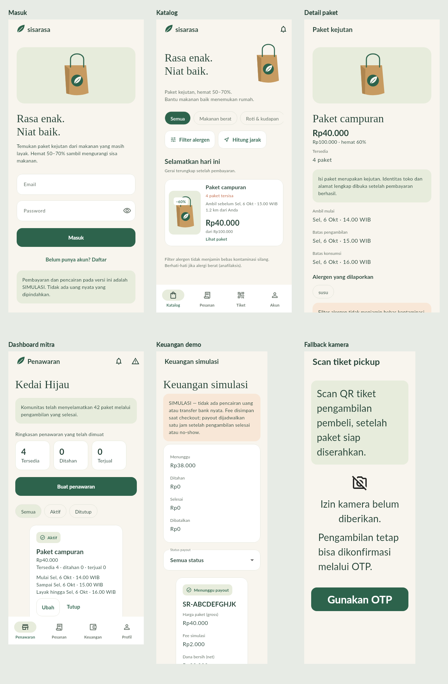

# SisaRasa

Android marketplace paket kejutan surplus makanan: penjual menerbitkan paket yang masih layak, pembeli memesan dengan diskon 50–70%, lalu mengambilnya memakai QR atau OTP. Identitas gerai dibuka sesudah pembayaran. Pembayaran, rekening, fee, refund dan pencairan **SIMULASI**, tanpa transfer uang nyata.



## Stack dan struktur

Diuji dengan Flutter **3.47.2**, Dart **3.13.2**, Node **22.18**, TypeScript **7.0.2**, Express **4.22**, PostgreSQL **15**, Docker Compose, Python **3.12**, JDK **21**, Android SDK **36**. Android minimum **10/API29**. Versi dependensi terikat di `backend/package-lock.json` dan `android-app/pubspec.lock`.

```text
android-app/       Flutter: screen → controller/repository → API/storage
backend/           Express: route → service → repository → PostgreSQL
  migrations/      Migrasi SQL bernomor dan constraint/index
  openapi.yaml     Kontrak HTTP
scripts/           Setup, start/stop, migrasi, seed, test, backup, build
compose*.yaml      API, worker, PostgreSQL; profil test dan VPS
cloudflared/       Konfigurasi tunnel opsional
deploy/            Reverse proxy HTTPS dan backup timer
backend/test/      Unit, integration, e2e, operasi dan profiling
android-app/test/  Controller, API/cache, widget dan aksesibilitas
android-app/integration_test/  Pengujian Android native
design/           Desain FigCraft final yang dapat diedit
docs/             Panduan operasi, traceability dan bukti verifikasi
```

## Mulai dari nol

Prasyarat Linux: Git, Docker Engine dengan plugin Compose, Python 3.12+, Node 22 dan npm. Pengguna harus dapat menjalankan `docker` tanpa prompt interaktif. Untuk Android pasang Flutter 3.47.2, JDK21, SDK36/build tools36 serta terima lisensi Android dengan `flutter doctor --android-licenses`. Periksa `flutter doctor` sebelum build.

```bash
git clone https://github.com/aniceswan/sarirasa.git
cd sarirasa/src
./scripts/setup.sh
./scripts/start.sh
./scripts/health.sh
./scripts/seed.sh
```

Setup membuat `.env` privat dengan secret acak, membangun image, menyiapkan PostgreSQL dan menjalankan migrasi. Tidak memerlukan akun layanan cloud. Seed opsional membuat akun/penawaran **fiktif**; kredensial baru tersimpan di `.secrets/demo-access.txt` (hanya pengguna lokal yang dapat membaca). File tersebut memuat akun pembeli dan mitra. Seed tidak dijalankan otomatis dan tidak mereset akun lama. Penawaran contoh berakhir dalam dua jam; buat ulang penawaran melalui akun mitra jika habis. Registrasi kedua peran juga tersedia dari aplikasi.

API lokal: `http://127.0.0.1:3100`; health: `/health/ready`. Database hanya bind localhost port55432. Bila port dipakai proyek lain, jalankan setup pertama dengan `API_HOST_PORT=3101 DB_HOST_PORT=55435 ./scripts/setup.sh`, lalu sesuaikan `API_BASE` pada build Android. Semua konfigurasi ada di [.env.example](.env.example). Jangan mengganti secret yang sudah dipakai pada database/tiket lama.

Jalankan di emulator Android:

```bash
cd android-app
flutter pub get --enforce-lockfile
flutter run --dart-define=API_BASE=http://10.0.2.2:3100
```

`10.0.2.2` adalah jembatan emulator ke host. Pada HP fisik gunakan endpoint HTTPS yang dapat dijangkau; [panduan VPS](docs/vps-deployment.md) dan [operasi/tunnel](docs/operations.md) menjelaskan setup operator. HTTP hanya di debug. Origin diatur saat build; pengguna tidak perlu melihat IP, URL server, UUID internal atau mengubah konfigurasi jaringan. Kontrol operator hanya muncul jika sengaja dibuild dengan `--dart-define=DEVELOPER_SETTINGS=true`.

## Fitur

| Use case | Implementasi |
| --- | --- |
| UC01 | Penawaran, diskon, kuota, delapan alergen, jadwal/batas konsumsi, konfirmasi kelayakan dan aturan edit/tutup |
| UC02 | Katalog anonim, kategori/filter alergen, lokasi opsional dan perkiraan jarak |
| UC03 | Checkout idempotent, invoice, pembayaran demo berhasil/gagal/kedaluwarsa, identitas gerai setelah paid |
| UC04 | Dashboard mitra, pesanan/jadwal, inbox persisten dan pembaruan pesanan |
| UC05 | QR sekali pakai, OTP, validasi online, tiket terenkripsi yang dapat dibuka offline |
| UC06 | Pengaduan dengan bukti privat, approve/reject, pembatalan dan refund, no-show dan worker timeout |
| UC07 | Riwayat status, ulasan hanya pesanan selesai, metrik paket terselamatkan dan pencairan simulasi |

[Pemetaan kebutuhan/kelas](docs/traceability.md) · [Kontrak API](backend/openapi.yaml) · [Skema dan atribut database](backend/migrations/001_initial.sql) · [Alur kerja tim](../CONTRIBUTING.md). Penanggung jawab dan kontribusi anggota dicatat melalui issue/PR yang benar-benar dikerjakan; baseline source tidak mengarang pembagian kontribusi individu.

## Pengujian lokal

Dari folder `src/`:

```bash
./scripts/test.sh
python3 scripts/test/signing_test.py
./scripts/benchmark.sh
```

`test.sh`: database PostgreSQL disposable port55433, `npm ci`, typecheck, backend/operasi backup, `flutter pub get`, analyze dan widget/unit test. Benchmark mereset database test yang sama, jadi jalankan berurutan, jangan paralel dengan backend tests. Semua fixture fiktif; data marketplace lokal di port55432 tidak digunakan oleh test.

Native E2E memerlukan API/worker lokal hidup dan emulator Android15 x86_64 **khusus pengujian**:

```bash
ANDROID_SERIAL=emulator-5580 ./scripts/e2e.sh
```

Runner memasang APK debug/instrumentation dan menyesuaikan sementara izin/timeout pada emulator. Jangan memakai HP pribadi berisi data pengguna. Marketplace harus mendahului recovery karena recovery menguji tiket dari proses sebelumnya. Jika build emulator lama ditandatangani dengan key lain, gunakan AVD pengujian kosong. Lihat [hasil verifikasi](docs/verification.md) untuk kondisi dan batas bukti; widget test tidak membuktikan kamera HP fisik.

## Build release dan operasi

```bash
./scripts/setup-signing.sh
./scripts/build-apk.sh https://HOST_API_ANDA
./scripts/backup.sh ./backups
./scripts/restore.sh ./backups/sisarasa-TIMESTAMP --test
./scripts/stop.sh
```

Signing key/password berada di `.secrets/` dan `android-app/android/key.properties`, tidak masuk Git. Build release menghasilkan `artifacts/sisarasa.apk` dan manifest SHA-256; tidak menggunakan debug key. Simpan APK sebagai asset Release tim, jangan commit binary build. Keystore harus dibackup privat agar update memakai identitas yang sama.

Database/media persisten saat stop. Backup menyertakan dump, media dan recovery secret, memulihkan layanan setelah kegagalan, serta menguji restore di tempat terpisah. Salin backup terenkripsi ke luar host. Jangan menghapus volume atau mengganti `PICKUP_KEY` saat tiket lama masih aktif.

Layanan finansial adalah simulasi; registrasi merchant bukan verifikasi fisik; informasi alergen/batas konsumsi berasal dari merchant dengan peringatan kontaminasi silang. Pemantauan notifikasi opt-in dan tunduk pada batas Android. Pengujian dua HP/kamera fisik, OEM dan kondisi 3G belum diklaim lulus.
